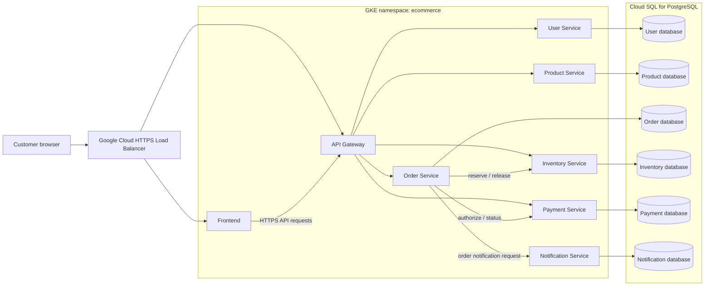
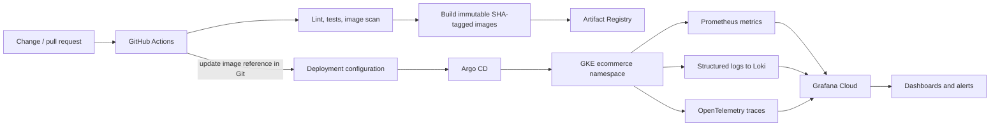

# Architecture and Implementation Plan

## Goals and constraints

- Provide a colorful, runnable learning storefront with a small number of
  independently running services before building out the full platform.
- Build independently deployable FastAPI services with clear ownership.
- Support local development and GKE Autopilot in `asia-south1`.
- Use the existing GKE cluster `ecommerce-learning` in project
  `abdulproject-510307` only after inspecting its configuration and current
  workloads. Do not recreate it or duplicate existing cloud resources.
- Keep infrastructure changes out of this architecture-only phase.
- Keep the initial learning setup cost-conscious without weakening production
  deployment defaults.

## High-level architecture



The diagram shows logical database boundaries, not a requirement for six
separately billed Cloud SQL instances. For a cost-conscious first deployment,
services may use separate databases and least-privilege database roles on one
Cloud SQL instance. The deployment design must preserve ownership and allow
services to be separated later. A service may access only its own database.

## Service responsibilities and contracts

| Component | Responsibilities | Owns |
|---|---|---|
| Frontend | Product browsing, cart UX, and demo checkout confirmation | Browser state and presentation |
| API Gateway | Public API routing, request limits and validation, JWT integration, consistent error handling | No business data |
| User Service | Registration, login, password hashing, JWT issuance, profile management | Users and credential hashes |
| Product Service | Product and category catalog, product details and published availability view | Products and categories |
| Order Service | Order creation, state transitions and customer order history | Orders and order items |
| Inventory Service | Stock updates, reservation and release, oversell prevention | Inventory and reservations |
| Payment Service | Simulated payment operations, status and idempotent transaction records; no card data | Payment records |
| Notification Service | Simulated order/payment notifications and delivery status | Notification records |

### Current demo implementation

The first runnable demo implements the storefront, API Gateway, Product Service,
and Order Service. The browser uses original local SVG product illustrations.
The Order Service fetches product prices from the Product Service and supports
idempotency keys; payment is deliberately not simulated as a successful charge.
Demo orders are held in memory and disappear when the service restarts. Login,
durable storage, inventory reservation, and production checkout are not part of
this demo.

The demo services expose health and readiness endpoints and use environment
configuration for service URLs. They log through Uvicorn; structured application
logging and Prometheus metrics are planned for later hardening. Readiness checks
should validate only dependencies necessary to serve traffic; liveness checks
should not restart a service merely because a downstream service is unavailable.

### Request and consistency model

- External traffic enters through HTTPS load balancing and the API Gateway.
  Internal services are ClusterIP-only.
- The gateway validates request shape, applies rate limits, and authenticates
  requests. Services also enforce authorization for their own operations; the
  gateway is not the only security boundary.
- Begin with bounded synchronous HTTP calls for order/inventory/payment flows.
  Apply deadlines, connection limits, and idempotency keys to operations that
  may be retried.
- The Order Service coordinates the initial checkout workflow. Inventory
  reservations are released if later steps fail. Payment processing is
  simulated and must not accept or persist card numbers, CVVs, or equivalent
  cardholder data.
- Do not imply a cross-database ACID transaction. Model order state and
  compensating actions explicitly. Add asynchronous events only with a
  separately documented broker and delivery guarantees.
- Notification failure must not silently turn a successful payment into a
  failed order; capture the notification outcome for retry/operations.

## Data architecture

Use SQLAlchemy, Alembic, PostgreSQL connection pooling, and explicit transaction
boundaries. Each service owns its migrations and schema/database credentials.
The initial logical ownership is:

| Service | Tables |
|---|---|
| User | `users` |
| Product | `products`, `categories` |
| Order | `orders`, `order_items` |
| Inventory | `inventory` (and reservation state) |
| Payment | `payments` |
| Notification | `notifications` |

No service reads or writes another service's tables. Use service APIs for
cross-service data and operations. Keep credentials in Secret Manager, mounted
or exposed to workloads using an approved GKE integration and Workload Identity;
never commit secrets or service-account key files.

## Runtime, delivery, and operations



- CI authenticates to Google Cloud using GitHub Actions Workload Identity
  Federation. It does not use a long-lived service-account JSON key.
- Image tags include the full Git commit SHA and are treated as immutable.
- The manual **Promote image to GKE** GitHub Actions workflow records an
  Artifact Registry image digest in the environment-specific Helm override.
  Configure environment protection rules for staging/production approvals.
- Argo CD is the deployer and reconciles the version committed to Git. GitHub
  Actions does not receive cluster credentials or apply to GKE.
- Use environment-specific values for dev, staging, and production. Promote
  image versions through reviewed Git changes; use Argo CD history and Git
  reverts for controlled rollback.
- Use Grafana Cloud rather than deploying a Grafana server in the cluster.
  Collect Prometheus metrics, Loki-compatible logs, and OpenTelemetry traces.
  Dashboards and alerts cover application health, service latency/errors,
  Kubernetes health, database performance, and deployment availability.
- Kubernetes workloads use non-root users, read-only filesystems where
  compatible, resource requests/limits, probes, least-privilege service
  accounts/RBAC, and network policies.
- Keep the base design compatible with GKE Autopilot. Document node-pool,
  taint, toleration, affinity, or other node-level examples as GKE Standard-only
  where Autopilot does not support or control them.

## Repository structure

The repository is organized so service code and deployable configuration can
evolve independently:

- `frontend/`, `api-gateway/`, and `services/*/` contain runtime applications.
- `shared/` contains only deliberately small shared libraries; business logic
  remains service-owned.
- `database/` holds local initialization and cross-service database setup
  documentation. Service migration ownership stays with each service.
- `docker/` supports local composition; `helm/` contains deployable charts.
- `kubernetes/` contains cluster-scoped and shared resources that do not belong
  in an individual chart.
- `argocd/` and `environments/` describe GitOps applications and environment
  overlays.
- `monitoring/` stores Grafana dashboards, alert definitions, and OpenTelemetry
  configuration.
- `.github/workflows/`, `tests/`, and `docs/` contain CI, cross-service checks,
  and operational guidance.

## Phased implementation

1. **Architecture and repository structure**: document boundaries, deployment
    model, and target layout. No cloud resources changed.
2. **Local storefront demo** (current): frontend, API Gateway, Product Service,
    Order Service, original artwork, Compose setup, and tests. No cloud resources
    or workloads changed.
3. **User Service**: FastAPI app, password hashing, JWT flow, tests, health
    endpoints, and service-owned persistence/migrations.
4. **Product Service hardening**: catalog/category persistence, migrations,
    tests, and service data ownership.
5. **Order Service hardening**: durable order lifecycle, history, and explicit checkout states.
6. **Inventory and Payment Services**: reservations/oversell protection and
    simulated idempotent payments without card data.
7. **Notification Service**: simulated delivery, persistence, and retryable
    status.
8. **Frontend and API Gateway hardening**: customer workflows, routing, authentication
    integration, validation, and rate limiting.
9. **Database integration**: connection pooling, per-service boundaries,
    migrations, local setup, and transaction/failure tests across implemented
    services.
10. **Docker builds**: secure, non-root images and local composition.
11. **GKE deployment**: inspect existing project/cluster/resources first, then
    deploy only required changes with Helm; do not recreate the cluster.
12. **Argo CD GitOps**: application/project definitions, environment overlays,
    image promotion, and rollback workflow.
13. **Grafana Cloud observability**: metrics, logs, traces, dashboards, alerts,
    and operational validation.

Each phase adds implementation-specific run commands, expected results, and
troubleshooting steps alongside tests. Later phases must validate the existing
phase before adding the next dependency.

## Phase 1 verification

From the repository root in PowerShell:

```powershell
Set-Location C:\Abdul
Test-Path .\architecture.md
Get-ChildItem -Directory | Sort-Object Name | Select-Object -ExpandProperty Name
```

Expected: `Test-Path` prints `True`, followed by:

```text
.github
api-gateway
argocd
database
docker
docs
environments
frontend
helm
kubernetes
monitoring
services
shared
tests
```

If `Test-Path` is false or the directories are missing, confirm the current
directory with `Get-Location` and repeat from the repository root. Phase 1
requires no `gcloud` or `kubectl` commands; inspecting or changing the existing
cluster is deferred until the GKE deployment phase.
